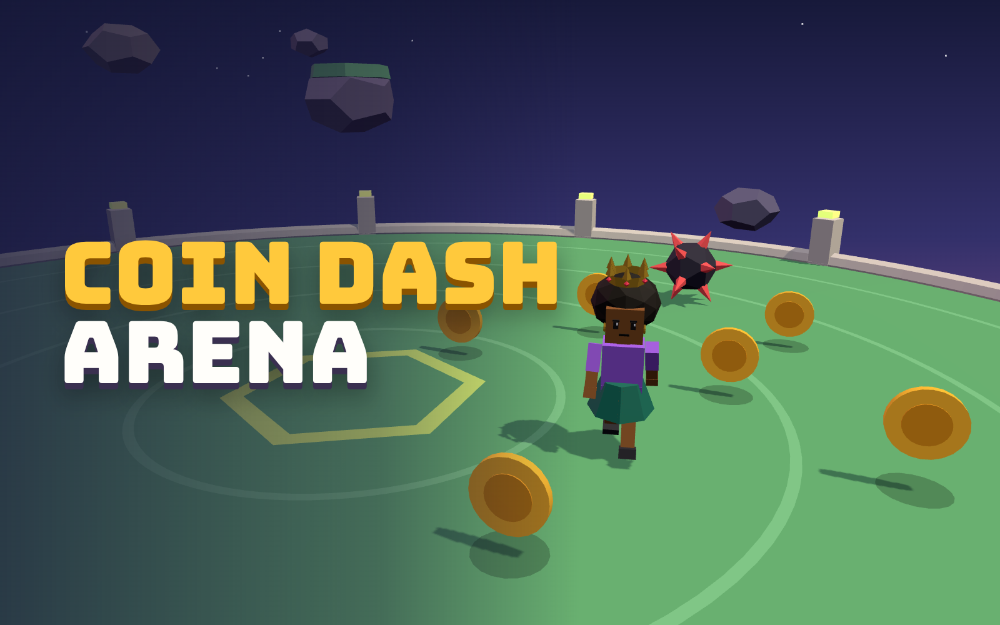

# Coin Dash Arena

A three.js arena game for [start.ng](https://start.ng). You play as your own start.ng character on a floating island: grab coins to keep the clock alive, dodge the spike balls, and see how long you last.



## How to play

| Thing | Effect |
| --- | --- |
| Coin | +1 point and +1.5 seconds |
| Time orb (blue) | +5 seconds |
| Spike ball | -5 seconds and a knockback |
| Dash (Space / Shift, or the Dash button on phones) | A quick burst that also lets you pass through danger |

Move with WASD or the arrow keys. On phones, use the joystick. Spike balls come faster and more often the longer you survive.

## How it uses start.ng

- **Logged-in players:** the game asks start.ng who is playing through the hidden connect page (`startng:whoami`, with an origin check). See `startng.js`.
- **Character styling:** `character.js` builds the 3D character from the player's `style`. Every field is used: `body`, `primaryColor`, `secondaryColor`, `skinColor`, `hairColor`, `hair` (short, afro, braids, bun, ponytail, dreads, bald), `hat` (none, cap, beanie, tophat, crown) and `accessory` (none, glasses, earrings, beard, scarf, backpack). Unknown values fall back to sensible defaults. Change your look on start.ng and come back to the tab: the character rebuilds itself.
- **Guests** get start.ng's guest look and a Sign in button.
- **Profile card** with the face picture, character name and `@account` at the top left.
- **Leaderboard** with two columns from `startng.json`: Coins and Survived time. Runs are saved for signed-in players.

## Files

```
index.html      page and UI
style.css       styles
game.js         scene, gameplay, camera, HUD
character.js    start.ng style -> three.js character
startng.js      connect-page helper (whoami, score, leaderboard, sign in)
startng.json    leaderboard columns
cover.png       1600x1000 card picture
vendor/         three.js r186 (bundled, no CDN needed)
fonts/          Bungee and Rubik (bundled, OFL)
```

No build step. start.ng serves these files as they are.

## Run it locally

ES modules need a local server (opening `index.html` as a file will not work):

```bash
npx serve .
# or
python3 -m http.server 8000
```

Locally there is no start.ng player, so you play with the guest look. To preview a look, add it to the address:

```
http://localhost:8000/?name=Snow&style={"body":"male","hair":"dreads","hat":"cap","accessory":"glasses","primaryColor":"%23e74c3c"}
```

## Publish to start.ng

1. Push this folder to a **public** GitHub repo.
2. Check it:

   ```bash
   curl -X POST https://api.start.ng/games/check \
     -H "Content-Type: application/json" \
     -d '{"repo_url":"https://github.com/YOUR-USERNAME/coin-dash-arena","name":"coin-dash-arena"}'
   ```

3. Publish it:

   ```bash
   curl -X POST https://api.start.ng/games/publish \
     -H "Content-Type: application/json" \
     -d '{"repo_url":"https://github.com/YOUR-USERNAME/coin-dash-arena","name":"coin-dash-arena"}'
   ```

4. Open the `approve_url` from the reply, sign in, and approve. The game goes live at `https://coin-dash-arena.start.ng` (or whatever name you chose).

After that, every `git push` updates the game automatically.
